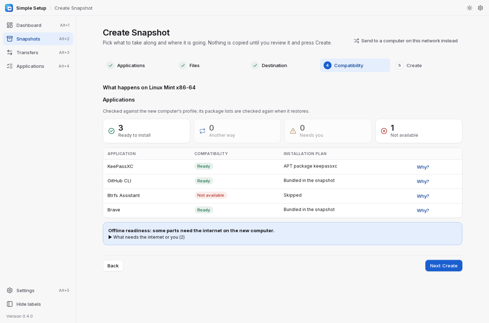

# Simple Setup

Move your apps, their settings and your files to another computer. Linux, Windows and macOS work
in any direction, and so do Linux distributions: moving from Fedora to Linux Mint is as simple as
moving between two Fedora computers. Pick what to bring, see what will happen on the new computer,
then save it as a snapshot on a drive or send it over your local network. On the new computer,
Simple Setup reinstalls the apps the way that system installs them and puts your settings and
files back.


- **Reinstalls apps**: from installers bundled in the snapshot (no internet needed), or the new
  computer's package managers (Flathub, winget, Homebrew, APT/DNF/Zypper/Pacman, snap), or
  downloads checked against their published SHA-256.
- **Converts settings between systems** for VS Code, Git, Firefox, Thunderbird, GitHub CLI
  and Neovim.
- **Never overwrites** existing files. Anything that can't be restored is reported and skipped,
  and it never stops the rest.
- **Leaves out secrets** (SSH keys, keyrings, browser logins, tokens) unless you opt in. Snapshots can be
  encrypted with a password.

A snapshot holds apps and data. It is not a disk image.

## Install

Download the file for your system from the
**[latest release](https://github.com/fleetwoodjohnr/simple-setup/releases/latest)**.

| System | File | How to install |
|---|---|---|
| Ubuntu, Debian | `Simple.Setup_<version>_amd64.deb` (ARM: `_arm64.deb`) | `sudo apt install ./Simple.Setup_*_amd64.deb` |
| Fedora | `Simple.Setup-<version>-1.x86_64.rpm` (ARM: `.aarch64.rpm`) | `sudo dnf install ./Simple.Setup-*.x86_64.rpm` |
| Any Linux | `Simple.Setup_<version>_amd64.AppImage` (ARM: `_aarch64.AppImage`) | `chmod +x Simple.Setup_*.AppImage`, then run it |
| Windows | `Simple.Setup_<version>_x64_en-US.msi` or `_x64-setup.exe` (ARM: `_arm64-setup.exe`) | Run it. If SmartScreen says "Windows protected your PC", choose **More info → Run anyway** |
| macOS | `Simple.Setup_<version>_aarch64.dmg` (Apple Silicon) or `_x64.dmg` (Intel) | Open it and drag Simple Setup to Applications. The first time, right-click the app and choose **Open → Open** |
| Command line only | `simple-setup-<version>-<os>-<arch>` | `chmod +x` it and run it (`.exe` on Windows). The desktop packages already include it |

The builds are not signed yet, which is why Windows and macOS warn the first time.

Check a download against the release's checksums:

```sh
sha256sum -c SHA256SUMS --ignore-missing      # macOS: shasum -a 256 -c SHA256SUMS --ignore-missing
```

> In v0.2.0, `SHA256SUMS` lists the packages with a space (`Simple Setup_…`) where GitHub serves a
> dot (`Simple.Setup_…`). Rename the download or compare its hash by hand. Later releases match.

More on packages, signing and the prompts each system shows:
[docs/PACKAGING.md](docs/PACKAGING.md).

## Use

The dashboard offers four things: **Create Snapshot**, **Transfer to Another Computer**,
**Restore Snapshot** and **Manage Snapshots**. Creating and transferring are the same five steps.

1. **Applications.** Search and tick apps; for each, choose **Reinstall**, **Settings** and/or
   **Data**.

   

2. **Files**, such as Documents or project folders. Keys, tokens and browser logins are left out
   unless you include them on purpose.
3. **Where it is going.**
   - **Transfer:** on the new computer open **Transfers → Receive on this computer**; it shows a
     pairing code. Type it here and choose **Connect**. Simple Setup asks that computer what it
     is (for example *Linux Mint 22, x86-64, APT, Flatpak*), so it prepares exactly what fits it.
   - **Snapshot:** *a computer like this one*, *another kind of computer* (pick its system,
     distribution and processor), or *not decided yet*. Then pick a drive or folder, and
     optionally a password.

   
4. **Compatibility.** Every app lands in one of four groups — *ready*, *another way* (for example
   a Flatpak instead of an RPM), *needs you* (an approval or a download), *not available* — with
   the installation plan and, behind **Why?**, every option that was considered. You never need
   to know RPM from DEB: a Fedora RPM is never sent to Linux Mint; Mint gets the app from its own
   repositories, Flatpak or a verified download instead.

   

5. **Start.** A snapshot is built and checked; a transfer is built in a temporary folder, sent,
   checked on arrival and removed here.

### On the new computer: restore

Open **Restore Snapshot** (or tick **Restore automatically when it arrives** when receiving).
The snapshot's integrity is checked, then the same compatibility summary appears, this time
checked against the computer's own package lists, followed by the plan: how each app is
installed and where each file goes. Items that need your approval (a package from a repository
the distribution doesn't vouch for, a source build, a read-only system) start unticked. Nothing
changes until you press **Start Restore**.


System packages ask for the administrator password once for all apps together. The migration
summary lists what was installed, restored, skipped and failed, with reasons and what is left for
you; **Retry failed** tries the failures again and **Export report** saves it. Running the restore
again skips what is already done.

### Linux distributions

Distributions are recognised from `/etc/os-release` and described by profiles: Fedora, RHEL and
its rebuilds, Fedora Atomic desktops, Debian, Ubuntu, Linux Mint, Pop!_OS, Zorin, elementary,
openSUSE (including MicroOS/Aeon), Arch, Manjaro, EndeavourOS, CachyOS, SteamOS, Alpine and NixOS
are built in. A distribution that isn't known is treated like the one its `ID_LIKE` names, or as
generic Linux. **Settings → Operating systems → Linux distributions** lists them; you can add one
with a short form (based on an existing one, so a new Ubuntu derivative needs only a name and its
os-release ID), import a JSON or YAML profile, or fetch official updates. See
[docs/DISTROS.md](docs/DISTROS.md).

**No Simple Setup on the new computer?** Every snapshot carries its own restore program, and a
`RESTORE.md` in its folder with the one command to run for each system and what each system gets:

| System | From the snapshot folder |
|---|---|
| Windows | Double-click `launchers\restore-windows.cmd` |
| macOS | Double-click `launchers/restore-macos.command` |
| Linux | `sh launchers/restore-linux.sh` |

Add `--dry-run` to see the plan first, or `--yes` to skip the questions.

### Keeping Simple Setup up to date

**Settings → Updates → Check for Updates**, then **Download Update** and **Restart and Install**.
Downloads are checked against the release's checksums, and your settings and snapshots are kept.

The full guide is in [docs/DEPLOYMENT.md](docs/DEPLOYMENT.md).

### Command line

The same engine also runs from a terminal:

```sh
simple-setup scan [--json] [--source-dir ~/projects]
simple-setup volumes
simple-setup schema                                       # JSON Schema of simple-setup.json
simple-setup profile show "Work Setup" > sel.json         # selections are explicit JSON; nothing is chosen for you
simple-setup snapshot preflight --selection sel.json --dest /run/media/me/USB
simple-setup snapshot create --selection sel.json --dest /run/media/me/USB --name "Work laptop"
simple-setup snapshot verify "/run/media/me/USB/Work laptop"
simple-setup snapshot list | show | delete | discard-partial
simple-setup restore "/run/media/me/USB/Work laptop" --dry-run
simple-setup restore "/run/media/me/USB/Work laptop" [--only r2] [--keep-both] [--password-file f]
simple-setup restore ... --offline                        # only what is in the snapshot: no downloads
simple-setup restore ... --no-source-builds               # never build apps from source
simple-setup snapshot create ... --encrypt                # asks for a password, prints a recovery key once
simple-setup snapshot create ... --base "/run/media/me/USB/Work laptop"   # update: only changes are copied
simple-setup receive [--dest DIR] [--restore [--yes]]     # new computer: shows a pairing code, waits;
                                                          # --restore restores as soon as it arrives
simple-setup peers                                        # computers nearby that are receiving
simple-setup probe [--to ADDR] [--code CODE]              # what a receiving computer is (nothing is sent)
simple-setup send "/run/media/me/USB/Work laptop" [--to 192.168.1.20:41234] [--code 1234-5678]
simple-setup system                                       # this computer: distribution, profile, package managers
simple-setup analyze SNAPSHOT [--as linuxmint:22] [--os windows] [--arch aarch64]   # compatibility, nothing changed
simple-setup snapshot create ... --for linuxmint          # prepare for a distribution (a profile ID)
simple-setup distros list | show | validate | import | export | enable | disable | remove | trust | update
```

## Limits

- Developed and tested on Linux. The Windows engine has run under Wine, and CI scans real Windows
  and macOS machines, but it hasn't yet been used on a real PC or Mac.
- Apps are matched by exact package IDs only. Unknown apps get manual instructions instead of a
  guess. Homebrew itself is not installed for you.
- Offline native package sets support DNF/RPM, APT, pacman and apk on the same distribution,
  release and processor. Other destinations use verified vendor packages, Flatpaks or AppImages
  where available, with online installation for missing dependencies. A vendor RPM alone is
  not a complete offline dependency set.
- Image-based systems (Fedora Atomic, openSUSE MicroOS) and Alpine are covered by profiles and
  tests on fixtures; installs on them have not been run on real machines.
- Source builds support Cargo, Go and pipx, but not make, CMake or npm.
- Network transfer works only on the local network.
- Settings of apps without a converter stay in the snapshot when moving to another system, and
  are reported as unsupported.

What works, what doesn't yet, and how each part was tested: [docs/STATUS.md](docs/STATUS.md).

## Build from source

Requires Rust 1.90+, Node 20+, and the [Tauri 2 Linux prerequisites](https://tauri.app/start/prerequisites/)
(`webkit2gtk4.1-devel`, `gtk3-devel`, `libsoup3-devel` on Fedora).

```sh
npm install
cargo build -p simple-setup-cli          # the CLI / restore engine (target/debug/simple-setup)
./scripts/build-restore-kit.sh           # static Linux restore programs (x86_64 + aarch64) in target/release/restore-kit,
                                         # used by target/release/simple-setup; needs the two musl rustup targets
npm run tauri dev                        # desktop app (finds the engine next to its own binary)
npx tauri build --debug --no-bundle      # self-contained debug build of the desktop app
./scripts/build-release.sh               # release packages + CLI + restore kit + SHA256SUMS in release/
```

The desktop app (Tauri 2 + React) and the CLI share one Rust engine (`crates/core`). The CLI is
also the restore program copied into every snapshot, so a new computer needs no Python, Node or
Rust. Tests: [docs/STATUS.md](docs/STATUS.md#tests).

## Docs

- [DEPLOYMENT.md](docs/DEPLOYMENT.md): the full user guide
- [PACKAGING.md](docs/PACKAGING.md): release files, signing, installing
- [ARCHITECTURE.md](docs/ARCHITECTURE.md): how it works inside
- [MANIFEST.md](docs/MANIFEST.md): the snapshot format
- [DISTROS.md](docs/DISTROS.md): Linux distribution profiles, compatibility decisions, adding a distribution
- [SECURITY.md](docs/SECURITY.md): secrets, encryption, transfer, profile trust
- [ACCESSIBILITY.md](docs/ACCESSIBILITY.md): WCAG checks
- [STATUS.md](docs/STATUS.md): what works, what doesn't yet, and test results
