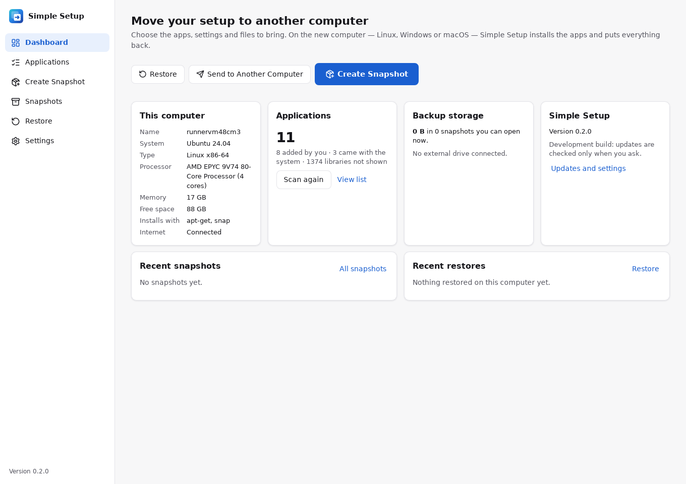
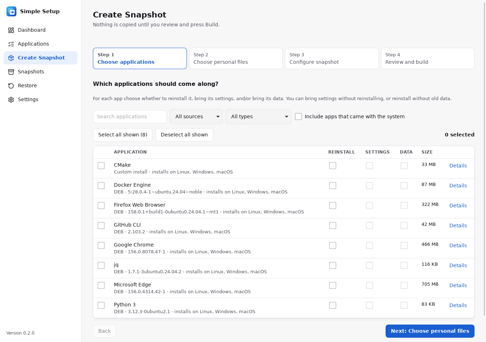
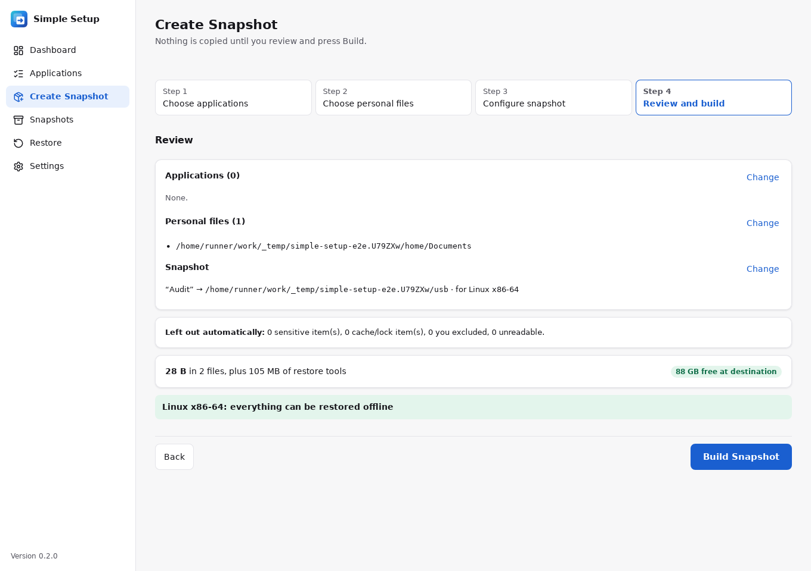
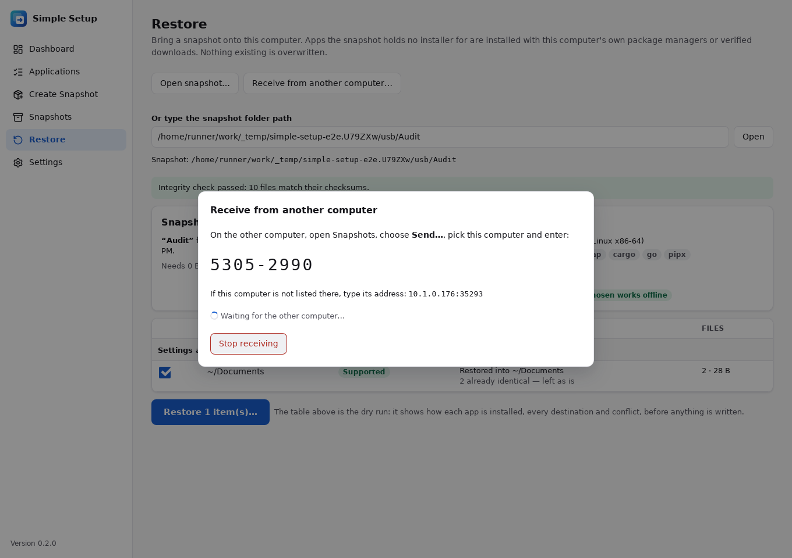
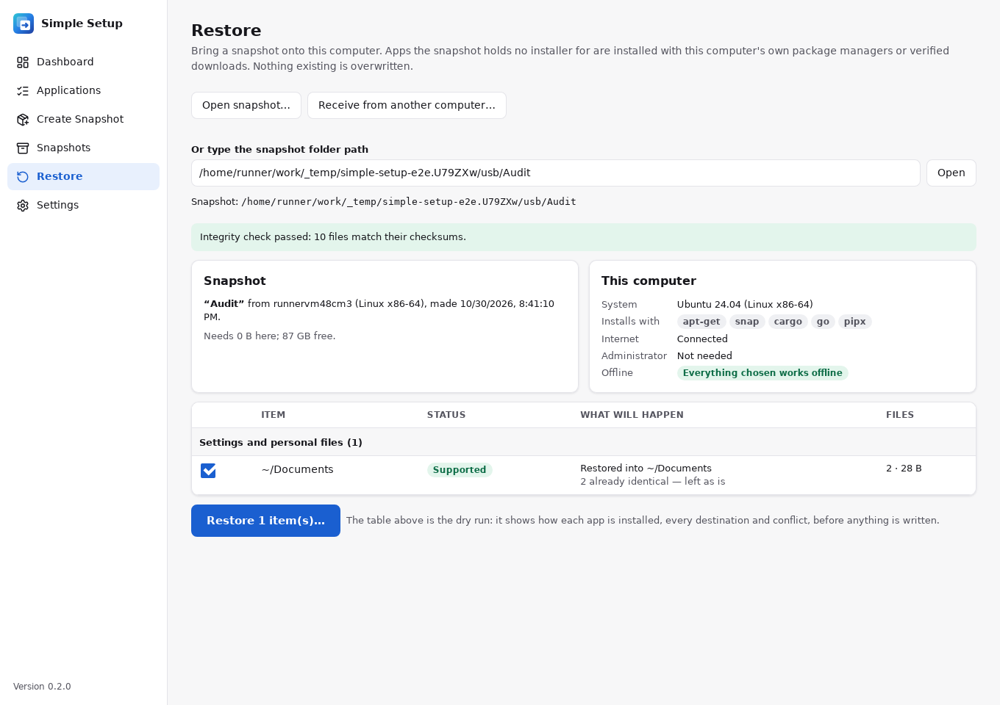

# Simple Setup

Move your apps, their settings and your files to another computer. Linux, Windows and macOS work
in any direction. Pick what to bring and save it as a snapshot on a drive or folder (or send it
over your local network). On the new computer, Simple Setup reinstalls the apps and puts your
settings and files back.



- **Reinstalls apps**: from installers bundled in the snapshot (no internet needed), or the new
  computer's package managers (Flathub, winget, Homebrew, APT/DNF/Zypper/Pacman, snap), or
  downloads checked against their published SHA-256.
- **Converts settings between systems** for VS Code, Git, Firefox, Thunderbird, GitHub CLI
  and Neovim.
- **Never overwrites** existing files. Anything that can't be restored is reported and skipped,
  and it never stops the rest.
- **Leaves out secrets** (SSH keys, keyrings, browser logins, tokens) unless you opt in. Snapshots can be
  encrypted with a password.

A snapshot holds apps and data. It is not a disk image.

## Install

Download the file for your system from the
**[latest release](https://github.com/fleetwoodjohnr/simple-setup/releases/latest)**.

| System | File | How to install |
|---|---|---|
| Ubuntu, Debian | `Simple.Setup_<version>_amd64.deb` (ARM: `_arm64.deb`) | `sudo apt install ./Simple.Setup_*_amd64.deb` |
| Fedora | `Simple.Setup-<version>-1.x86_64.rpm` (ARM: `.aarch64.rpm`) | `sudo dnf install ./Simple.Setup-*.x86_64.rpm` |
| Any Linux | `Simple.Setup_<version>_amd64.AppImage` (ARM: `_aarch64.AppImage`) | `chmod +x Simple.Setup_*.AppImage`, then run it |
| Windows | `Simple.Setup_<version>_x64_en-US.msi` or `_x64-setup.exe` (ARM: `_arm64-setup.exe`) | Run it. If SmartScreen says "Windows protected your PC", choose **More info → Run anyway** |
| macOS | `Simple.Setup_<version>_aarch64.dmg` (Apple Silicon) or `_x64.dmg` (Intel) | Open it and drag Simple Setup to Applications. The first time, right-click the app and choose **Open → Open** |
| Command line only | `simple-setup-<version>-<os>-<arch>` | `chmod +x` it and run it (`.exe` on Windows). The desktop packages already include it |

The builds are not signed yet, which is why Windows and macOS warn the first time.

Check a download against the release's checksums:

```sh
sha256sum -c SHA256SUMS --ignore-missing      # macOS: shasum -a 256 -c SHA256SUMS --ignore-missing
```

> In v0.2.0, `SHA256SUMS` lists the packages with a space (`Simple Setup_…`) where GitHub serves a
> dot (`Simple.Setup_…`). Rename the download or compare its hash by hand. Later releases match.

More on packages, signing and the prompts each system shows:
[docs/PACKAGING.md](docs/PACKAGING.md).

## Use

### 1. On the old computer: make a snapshot

Open **Create Snapshot**.

1. **Choose applications.** For each app, tick **Reinstall**, **Settings** and/or **Data**.

   

2. **Choose personal files**, such as Documents or project folders.
3. **Configure.** Pick a drive or folder for the snapshot. Under **Restore on**, tick every kind
   of computer you might restore it on, so the snapshot carries installers and a restore program
   for each. You can also set a password here.
4. **Review and build.** The review shows the size, the free space, and what will restore
   offline on each system.

   

### 2. Get it to the new computer

- **By drive:** plug the drive into the new computer.
- **Over the network:** on the new computer, choose **Restore → Receive from another computer**.
  It shows a pairing code. On the old computer, choose **Snapshots → Send…**, pick the new
  computer and type the code. Tick **Restore automatically when it arrives** for a hands-off
  restore.

  

### 3. On the new computer: restore

Install Simple Setup, open **Restore** and choose the snapshot. Its integrity is checked first.
The table that follows is the dry run: it shows how each app will be installed and where each
file goes. Nothing changes until you press **Restore**.



Apps the snapshot has no installer for are installed with the computer's own package managers
first, then with verified downloads. APT/DNF/Zypper/Pacman/snap ask for the administrator password
once for all apps together. When it finishes, a report lists how each item was restored, and
**Retry failed** tries the failures again. If you run the restore again, it skips what is already
done.

**No Simple Setup on the new computer?** Every snapshot carries its own restore program:

| System | From the snapshot folder |
|---|---|
| Windows | Double-click `launchers\restore-windows.cmd` |
| macOS | Double-click `launchers/restore-macos.command` |
| Linux | `sh launchers/restore-linux.sh` |

Add `--dry-run` to see the plan first, or `--yes` to skip the questions.

### Keeping Simple Setup up to date

**Settings → Updates → Check for Updates**, then **Download Update** and **Restart and Install**.
Downloads are checked against the release's checksums, and your settings and snapshots are kept.

The full guide is in [docs/DEPLOYMENT.md](docs/DEPLOYMENT.md).

### Command line

The same engine also runs from a terminal:

```sh
simple-setup scan [--json] [--source-dir ~/projects]
simple-setup volumes
simple-setup schema                                       # JSON Schema of simple-setup.json
simple-setup profile show "Work Setup" > sel.json         # selections are explicit JSON; nothing is chosen for you
simple-setup snapshot preflight --selection sel.json --dest /run/media/me/USB
simple-setup snapshot create --selection sel.json --dest /run/media/me/USB --name "Work laptop"
simple-setup snapshot verify "/run/media/me/USB/Work laptop"
simple-setup snapshot list | show | delete | discard-partial
simple-setup restore "/run/media/me/USB/Work laptop" --dry-run
simple-setup restore "/run/media/me/USB/Work laptop" [--only r2] [--keep-both] [--password-file f]
simple-setup restore ... --offline                        # only what is in the snapshot: no downloads
simple-setup restore ... --no-source-builds               # never build apps from source
simple-setup snapshot create ... --encrypt                # asks for a password, prints a recovery key once
simple-setup snapshot create ... --base "/run/media/me/USB/Work laptop"   # update: only changes are copied
simple-setup receive [--dest DIR] [--restore [--yes]]     # new computer: shows a pairing code, waits;
                                                          # --restore restores as soon as it arrives
simple-setup peers                                        # computers nearby that are receiving
simple-setup send "/run/media/me/USB/Work laptop" [--to 192.168.1.20:41234] [--code 1234-5678]
```

## Limits

- Developed and tested on Linux. The Windows engine has run under Wine, and CI scans real Windows
  and macOS machines, but it hasn't yet been used on a real PC or Mac.
- Apps are matched by exact package IDs only. Unknown apps get manual instructions instead of a
  guess. Homebrew itself is not installed for you.
- Source builds support Cargo, Go and pipx, but not make, CMake or npm.
- Network transfer works only on the local network.
- Settings of apps without a converter stay in the snapshot when moving to another system, and
  are reported as unsupported.

What works, what doesn't yet, and how each part was tested: [docs/STATUS.md](docs/STATUS.md).

## Build from source

Requires Rust 1.90+, Node 20+, and the [Tauri 2 Linux prerequisites](https://tauri.app/start/prerequisites/)
(`webkit2gtk4.1-devel`, `gtk3-devel`, `libsoup3-devel` on Fedora).

```sh
npm install
cargo build -p simple-setup-cli          # the CLI / restore engine (target/debug/simple-setup)
./scripts/build-restore-kit.sh           # static Linux restore programs (x86_64 + aarch64) in target/release/restore-kit,
                                         # used by target/release/simple-setup; needs the two musl rustup targets
npm run tauri dev                        # desktop app (finds the engine next to its own binary)
npx tauri build --debug --no-bundle      # self-contained debug build of the desktop app
./scripts/build-release.sh               # release packages + CLI + restore kit + SHA256SUMS in release/
```

The desktop app (Tauri 2 + React) and the CLI share one Rust engine (`crates/core`). The CLI is
also the restore program copied into every snapshot, so a new computer needs no Python, Node or
Rust. Tests: [docs/STATUS.md](docs/STATUS.md#tests).

## Docs

- [DEPLOYMENT.md](docs/DEPLOYMENT.md): the full user guide
- [PACKAGING.md](docs/PACKAGING.md): release files, signing, installing
- [ARCHITECTURE.md](docs/ARCHITECTURE.md): how it works inside
- [MANIFEST.md](docs/MANIFEST.md): the snapshot format
- [SECURITY.md](docs/SECURITY.md): secrets, encryption, transfer
- [ACCESSIBILITY.md](docs/ACCESSIBILITY.md): WCAG checks
- [STATUS.md](docs/STATUS.md): what works, what doesn't yet, and test results
